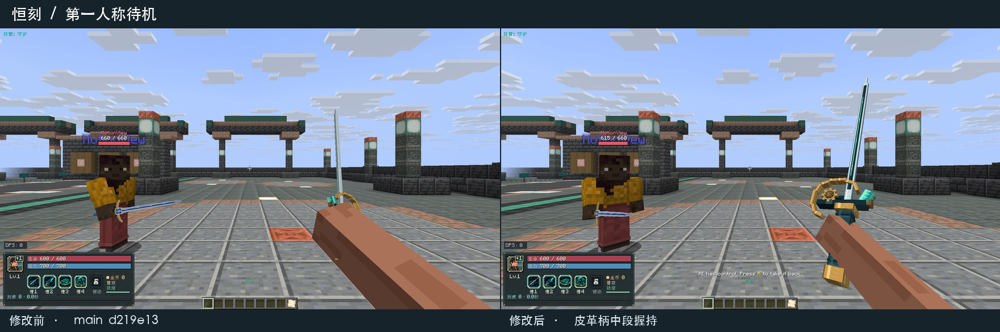
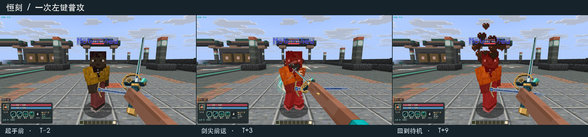
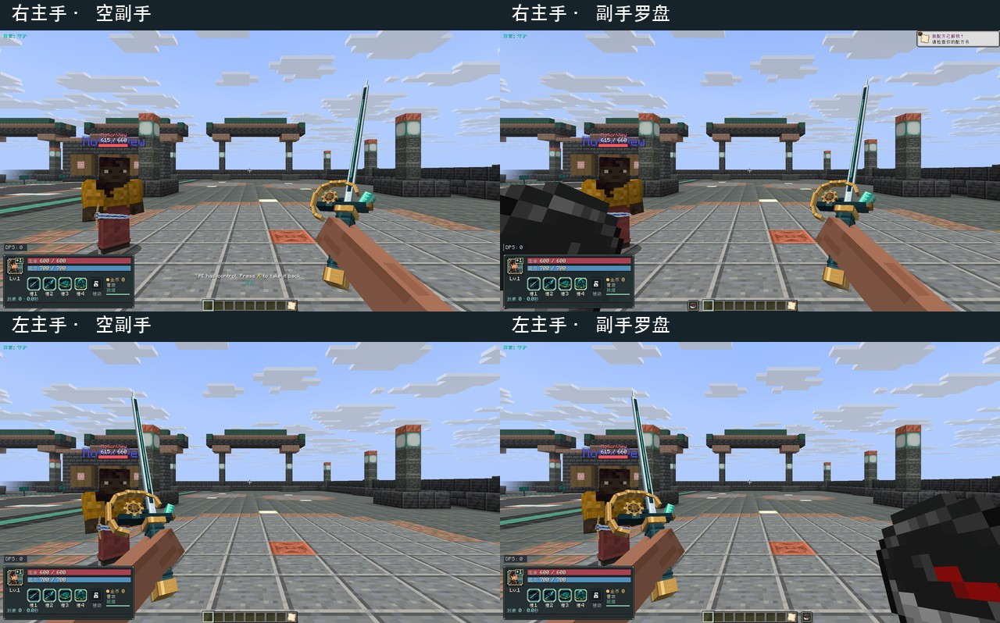

# 残月三式与第一人称握持

## 残月三式

收鞘开招后，每刀分别点按一次当前绑定的技能键。第一刀原地出手。第二、三刀短按原地斩；长按约 0.15 秒，沿出发时的朝向追斩。按下即进入原有的 4 行动 tick 起手，长按判定使用独立的三刻门槛。客户端明确发送本次点按或长按的选择。若起手已结束而手势消息还在路上，服务端短暂保留准备好的这一刀，仍只结算一次。

追斩每段最多 4 格。向前扫到合法敌人的身体时，在两者身体边缘相距约 1 格处收步；贴脸不后退，墙体挡路时在真实停点出刀。冲刺途中没有斩击。落刀时根据此刻朝向和遮挡重新判断目标，对方可以横移躲开。

前两刀各开 40 真实 tick 的续段窗口。前一刀可预计落地前的最后三刻可保留一次新按下的输入，到实际开窗时再走原续段入口。追斩起步会撤去这份预留，按住一次不能自动连出下一刀。连续命中同一目标三次才会附加禁锢，空刀计入技能槽月牙显示。已出鞘开招仍是单次「回月终斩」。

## 握持调整

| 角色 | 原画面与调整 |
| --- | --- |
| 伊珂 | 炮身在持械侧改为低托，准星下方可辨出炮身的长度。持械手和炮从同一握点后坐，空闲副手在架炮时托住炮身。 |
| 刻衡 | 恒刻以皮革柄中段为握点，第一人称模型等比缩放 1.18 倍。前臂降低，齿轮、护手和青色剑脊朝向镜头。出刺时手掌向前、向内送，剑尖转向准星。 |
| 云笙 | 第三人称以四个玉节围出的提环中心为握点，铃口向下。实机基线还显示第一人称铃腹大半落在下沿，所以独立调高了本人持铃的位置。 |
| 朔 | 上移、内收第一人称鞘口。收鞘、追斩与出刀共用连续的持械姿势；副手持物时由主手完成三刀。 |
| 赤霄 | 待机画面只露出大刀上部。抬起握点、转出刃面，武器按 1.20 倍绘制，露出护手。 |
| 凌渊 | 将低于画面边缘的握柄抬入画面，剑身略向持械侧展开，武器按 1.20 倍绘制。 |
| 焚诀 | 抬高待机持刀位置，转动刀面，保留切击时单刃沿实际挥向领先的动作。 |
| 夜影 | 转开反握手腕和短刃，刀体按 1.15 倍绘制，保留反握与技能中的换握。 |
| 墨尘、素岚 | 左主手时分别镜像阵旗、风刃、持械手与贴手特效，使用对应的左右袖口。副手持物时让出辅助动作。 |
| 天刑 | 雷剑的双手动作仅在副手空闲时调用辅助臂。夜影和焚诀的双手动作也遵守这一条件。 |

落霞、铆钉、寒泽和青萝沿用原有持械参数。此前在 #65 比较过赤霄与刻衡的三档尺寸。赤霄继续采用当时选定的 1.20 倍。刻衡改为上表的独立模型缩放。

## 刻衡点刺实机复核

用合并 #65 后的 `d219e13` 和修复版分别构建发行 JAR，在新建的合成训练场启动独立服务器、持剑玩家和陪练玩家。两版均固定 FOV 70、站位和视角。下图左侧为本轮重新运行的主线基准。旧验证包中的三档尺寸图记录的是 #65 当时的握持。

一次命中取自原生鼠标左键。以服务端发送七刻普攻动作的时刻为 T，T+3 的画面可见剑尖前送，T+9 已回到待机。视频按同一服务端事件对齐两次录制，依次播放原速和四分之一速回放。[查看 6 秒实机对照视频](assets/hero-motion/rapier-thrust.mp4)

| 复核项 | 本轮记录 |
| --- | --- |
| 普攻与镜头 | 左、右主手各测空副手和副手拿罗盘。每次均只发出一次 `RAPIER`，陪练生命从 660 降至 615.1724。四组持剑端各采集 18 帧，偏航均为 0°、俯仰均为 7°。朝空处左键时，两版均无 `RAPIER`，陪练生命保持原值。 |
| 迟针与终刻贯穿 | 迟针收到 `NEEDLE_READY → NEEDLE`。终刻蓄势中主动转头 18°，仍收到 `LINE_READY → LINE`。另一次蓄势中移位打断，收到 `RELAX`，此次没有贯穿动作。 |
| 其他动作 | 分别触发错拍步、迟界、一秒之外、随行秒域。记录到随行自然结束、二段主动取消、恒步获盾及第三次迟针命中触发刻痕回响。伊珂待机与陪练视角另外采了主线和修复版对照。 |

本轮离线构建及发行包命名空间检查通过。刻衡、伊珂、B 组角色和朔专项各通过 1/1。`first_group` 首轮停在朔的第八刻收鞘断言，同一修复包单独复跑通过 1/1。主线对照首轮则停在落地脉冲次数断言。画面与点刺手感留待玩家确认。
