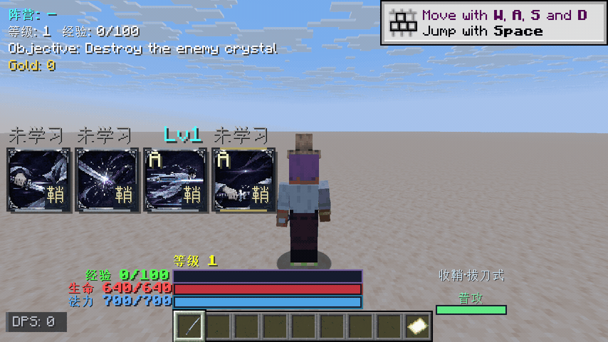

# MCPFabric 万象输入适配与朔“一闪”实测

2026-11-13，MC 26.2 / NeoForge 26.2.0.88 / MCPFabric 0.10.0，新测试世界 `run-mcpfabric/saves/New World`。用户授权保存并重启该测试客户端以加载适配；未操作正式实例。资源复用固定共享目录，启动时跳过资源下载。

## 实现与边界

`tools/mcpfabric/client-adapter/java/com/myriad/acceptance/MyriadInputBridge.java` 仅由 `myriadMcpClient` 测试配置编译。适配扩展 MCPFabric 原有路由及认证，不新开网络端口。动作沿用 player-control/vision 开关及玩家 STOP；只读令牌不能调用新增方法。

技能键调用原生 `KeyboardHandler.keyPress`，鼠标调用 `MouseHandler.onButton`，GUI 坐标经 `onMove` 转换；技能仍走项目既有按键事件、网络请求和服务端检查，没有直接改技能等级、法力或冷却来冒充成功。未绑定或冲突的映射临时借用空闲 F13–F25，按时释放并恢复原绑定，不保存到设置。

新增 MCP 工具为 `myriad_state`、`myriad_input`、`myriad_release_inputs`、`myriad_capture`、`myriad_capture_status`，加上上游工具共 54 个。帧记录含客户端 tick、法力、技能冷却、位置和相机视角；GPU 读回后的实际采样间隔不保证严格等于请求值。

## 操作与观察

1. 通过原有管理员命令在新世界启用模组及训练模式，选择 `shuo`。训练的无冷却、无限法力没有开启：后续实际观察到扣蓝及冷却。
2. 使用 `key.myriad.info` 打开 `FirstGroupScreen`。截图确认“一闪”的学习按钮；用原生鼠标坐标点击后，服务端回传 `shuo_yishan=1`，技能点由 1 变为 0。
3. 第三人称，对放置的静止尸壳目标按 `key.myriad.skill_e`，同步连拍 30 帧。看到了蓄势进度、出鞘、刀光和命中闪光、目标受击及伤害飘字；目标死亡。
4. 原生右键后，再次施法前的画面显示收鞘状态和蓄势，确认回鞘动作到达正常处理链。切回第一人称，使用项目命令生成训练假人，再次释放“一闪”并连拍 30 帧；观察到第一人称刀/鞘、起手、出刀和命中伤害飘字。
5. 最终 `myriad_release_inputs` 返回 `heldInputs=0`，原生按键事件累计 12、鼠标事件累计 4；测试窗口保留在世界内。

| 证据 | 第三人称 | 第一人称 |
|---|---|---|
| Capture ID | `2e7a8704-f421-44d0-9344-779fecb6ce37` | `1bb42aba-e5e1-4543-a299-8ba5bcccc81f` |
| 完成帧数 | 30 | 30 |
| 首末帧 tick 差 | 49 | 46 |
| 初始 / 最低法力 | 700 / 620 | 700 / 620 |
| 采样最大 E 剩余冷却 | 216 tick | 217 tick |
| 初始 / 结束 Z | 7.500 / 13.712 | 13.712 / 19.925 |
| 结束持有输入 | 0 | 0 |

完整 PNG 和每帧状态位于 `run-mcpfabric/screenshots/myriad/<Capture ID>/`，以上两组 `capture.json` 均返回 `complete=true` 且没有错误。已实际查看第三人称第 3、8、13、19 帧和第一人称第 3、8、12 帧。

第三人称实测连拍预览（从上述原始帧按实际 tick 间隔导出）：

## 构建与验证范围

- 测试适配 `compileMcpAdapterJava --offline` 通过。
- 普通 `bash ./gradlew build --offline --console=plain` 通过；已检查发行 JAR 不含 `/acceptance/` 类。适配不是正式游戏能力，不自动部署。
- 实际 MCP 握手列出 54 个工具，状态读取、界面/鼠标、技能输入、自动释放及两次连拍已运行。
- 本轮证明朔“一闪”的上述客户端控制和观察链路可用；未覆盖其他角色、地面选点确认/取消、长按组合、多人同步、控制打断、全部技能或完整美术/性能验收。没有据此宣称全量回归或平衡验证通过。
- 截图里仍有新世界教程提示，现有 HUD 也覆盖部分视野；第一人称穿过假人时目标模型短暂挡住画面。因此这些截图是输入与表现链路的实测证据，不是无干扰的宣传画面或完整视觉质量验收。
