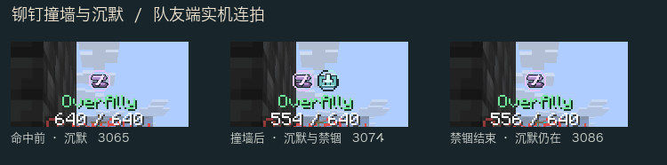

# 英雄头顶控制提示 · 2026-11-26 实机记录

在 Minecraft 26.3 / Fabric 独立合成服上，四个独立客户端组成 2v2。双方各一名玩家能同时看到同一名受控英雄的状态，队友与敌方分别沿用绿色和红色血条。受控者在第一、第三人称都使用本人 HUD。以下三张是同一轮控制的原始画面。

[受控者本人](assets/overhead-controls/close-owner.png) · [队友视角](assets/overhead-controls/close-ally.png) · [敌方视角](assets/overhead-controls/close-enemy.png)

## 技能与计时

| 触发方式 | 观察结果 |
| --- | --- |
| 天刑以原生 E 键施放「斩雷」 | 观察端实际收到了普通禁锢。24 帧连拍记录了从出现到消失的过程。 |
| 天刑以原生 R 键施放「雷霆裁决」 | 观察端实际收到了眩晕。第二段 24 帧连拍记录了对应星旋图标。 |
| 测试服向玩家施加沉默，敌方铆钉以原生 Q 键施放「冲击锤」 | 角色被推到墙上后，沉默与铆钉禁锢并列。服务端第 3073 刻分别剩 93 和 9 刻，第 3083 刻分别剩 83 和 0 刻。队友端共录到 22 帧。 |
| 在同一目标上施加三种状态、提高韧性、先缩短再延长沉默、净化及自然到期 | 权威读数随结算变化。6 刻短控制进入观察者快照；只有普通减速与缓时时，三项读数全为零。 |

沉默通过隔离测试服直接调用现有沉默系统施加。素材只有前三枚接入头顶，另外十三枚供后续复用。边环以 40 刻为满环，最后 40 刻匀速衰减。同类刷新使用最新真实余时。

## 可见性与清理

- **个人视线与队伍迷雾。** 一名敌方玩家被立柱遮挡时，其客户端收到的正式快照中没有目标条目；同队侧面的客户端仍收到了目标与控制余时。绕出后恢复当时的读数。草内敌人在队友取得视野前后，服务端快照也随之切换。[隔柱视角](assets/overhead-controls/pillar-wide-enemy.png) · [侧面队友视角](assets/overhead-controls/pillar-wide-side.png)
- **隐身与复活等待。** 隐身敌人从存活观察者快照中移除。跟随这名观察者的待复活玩家即使仍收到敌方血条，三项控制也全为零。解除隐身后恢复。两名队友同时阵亡时，把发光敌人移到复活点附近，仍可复现「血条有条目、控制为零」。
- **训练与生命周期。** 未选角目标有血条时，观察端的三项控制为零。目标选角后，未选角的观察者能看到该英雄实际受到的沉默。目标阵亡、退出训练或断线后，从合格观察者快照中移除；重新进入训练时，同一实体编号没有带回原状态。正式局结算回大厅后，四端缓存均已清空。断线端的缓存也已清空。
- **快照顺序。** 在已连接的测试客户端重排样本，覆盖本地先归零、较新权威样本校正、较旧的清零与控制样本迟到、场景重置、维度不符及新连接从低序号重启。单独暂停合成专服后，客户端走过 33 个本地刻。画面中旧标牌过期，服务器恢复后重新显示当前状态。乱序样本由测试探针注入，实际联网记录另存。

## 缩放与多人布局

默认 HUD 下，近处每枚 12 个 GUI 像素。最终尺寸至少 8 像素时显示全部有效项，6 至不足 8 像素只显示最高优先级，低于 6 像素收起。14 格单枚、18 格整行收起，20 格仍符合服务端距离资格，超过 20 格时血条条目保留、控制清零。先按相同高度重测了 20 格边界。

四端在最少粒子配置下采集。854 × 480、427 × 240 及 320 × 180 均以客户端读回的 GUI 逻辑尺寸为准。320 × 180 使用测试端调整实际窗口与 GUI 比例取景。该尺寸下默认战斗 HUD 和小地图占据较大面积，画面拥挤程度留给玩家判断。靠近屏幕顶边时观察到状态行先收起，姓名和血量仍在原位；多人重叠时状态行给英雄原有标牌让位。[427 × 240 原帧](assets/overhead-controls/gui-427.png) · [320 × 180 原帧](assets/overhead-controls/gui-320.png)

16 张 PNG 均已核对 32 × 32、sRGB、RGBA、透明边距及发行包内容。联系表提供彩色、灰度和 32 / 16 / 12 / 10 像素预览，另附三种实机背景的离线缩放样张。[图标映射与联系表](../../art/control_status/README.md)

## 构建与验收边界

- 独立功能分支实测时，发行 JAR、合成服及四个客户端加载的发行包 SHA‑256 均为 `081df0f6f4e4ddf02f048b77d3eb15bcb7a38fad5e92da7eed2cd4421abc518a`。协议为 29。另用真实协议 28 客户端连接协议 29 专服，在配置握手阶段收到版本不匹配提示并断开。
- `build` 与发行包命名空间检查通过。Fabric GameTest `myriad:combat_feedback` 为 1/1。独立训练服 fixture 的 45 项断言通过，含未选角目标和未开启切磋的观察者两项新增断言。
- 测试客户端副本仅去掉三张运行时图标，其余 JAR 条目逐一比对相同。实际画面显示三种备用轮廓。[缺图回退原帧](assets/overhead-controls/missing-art.png)
- 四客户端实机、专服进程内测试玩家、客户端模拟乱序分别记录。正式实例与正式存档未部署。全套小尺寸图标的主观辨识度、极窄窗口团战阅读体验等待人工确认。

## 合并前的协议复测

主线 #63 已使用协议 29，英雄血条报文随本次改动升至协议 30。合并前构建、命名空间检查与 `myriad:combat_feedback`（1/1）均通过。合成专服和两个客户端加载的 JAR SHA‑256 为 `53194994321b1b34e1fb357b354805bc475ca568f60f54fd07ca05e061ef7a62`。

两个协议 30 客户端进入同一训练场，观察端显示三枚图标。第 521 刻，服务端给观察者的眩晕、沉默、禁锢余时分别为 187、207、227 刻，与受控者实际读数一致。使用 #63 的协议 29 客户端连接时，在进入世界前收到版本不匹配提示。[协议 30 观察端原帧](assets/overhead-controls/protocol-30-observer.png)
