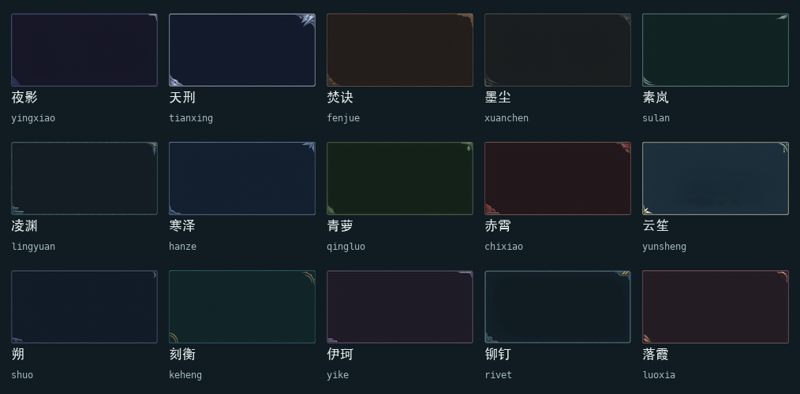

# 界枢面板与角色技能介绍卡

2026-11-26 在 Minecraft 26.3、Fabric Loader 0.20.1 的独立合成场地测试。技能、属性与补给页共用界枢底板，每个角色的八个候选技能共用该角色的介绍卡。源图为 1024×512，发行 JAR 内的界枢为 512×256，技能卡为 256×128。全部使用 sRGB RGBA PNG，固定角饰和可拉伸的直边分别绘制。

## 实机画面

| 场景 | 截图 |
| --- | --- |
| 960×540，完整 C 面板 | [界枢面板](assets/skill-panel-materials/panel-wide.png) |
| 320×180，在选中技能后移出图标 | [窄屏与底部确认区](assets/skill-panel-materials/panel-320.png) |
| 夜影「影杀」，暗银刃口和靛紫影帛 | [技能悬停](assets/skill-panel-materials/hover-yingxiao.png) |
| 焚诀「烈焰斩」，玄岩裂缝与余烬 | [技能悬停](assets/skill-panel-materials/hover-fenjue.png) |
| 云笙「纸鹤传音」，青釉铃沿和纸鹤折角 | [技能悬停](assets/skill-panel-materials/hover-yunsheng.png) |
| 铆钉「牵引索」，427×240 英文，方头锚栓和警戒刻槽 | [技能悬停](assets/skill-panel-materials/hover-rivet.png) |

## 资源与回退

- 在真实训练客户端将粒子设为最少，依次切换全部 15 名角色。每人读取到八个候选技能，实际悬停一个图标，核对图集命中的角色 ID 和屏幕上的卡片。每次换角重新选取对应底板。
- 用测试资源包屏蔽夜影贴图后，夜影显示通用卡，焚诀仍使用自身底板。同时屏蔽夜影和通用卡后，夜影使用纯色绘制，介绍、减速与风墙限制仍可读。撤下测试资源包并重新加载，恢复夜影卡。在真实客户端的图集上，另核对了未登记 ID 的通用回退。
- 检查全部 17 张运行贴图的尺寸、四角透明度和中央 80% 宽 × 76% 高区域的不透明度。以该区域各自最亮像素对照五种文字颜色，最低对比度为 6.91∶1。另外在四张实际悬停截图中，沿 34 行可识别文字的字形上缘采样，五种文字颜色与相邻背景的最低采样对比度为 7.40∶1。本次门槛为 4.5∶1。

## 构建与操作

- 执行离线 Gradle 构建、发行 JAR 命名空间审计和 `myriad:training_ui` GameTest。专项 1/1 通过，涵盖 108 组响应式布局和 3,456 组浮层边界检查。JAR 内的 17 张运行贴图及其九宫格元数据与导出文件逐一一致。
- 测试服务器、两个客户端和本地构建包的 SHA256 均为 `67e91b7f0bbbbae64e7c4932c2107bca68094d0bb8f5aaba262f9ca4e3d883d6`。
- 在训练场实测鼠标移入、移出、裁剪边缘和滚动，单击选中、双击学习与 Tab、Enter 确认。互斥分支仍可预览，已满级、训练免耗和训练无冷却均有对应文字。换角后首帧重新绘制时，旧选中项与滚动位置清空。
- 抽查夜影「回影」免费回返倒计时、伊珂炮台姿态的剩余炮弹和朔「鞘返」的格挡说明。属性与补给显示各自原有提示，H 大厅可进入角色图鉴，关闭后可见战斗 HUD。
- 两名真实客户端通过大厅排队、少人开局与选角进入 1v1。夜影在正式对局学习一级「影杀」，卡片显示蓝耗 70、冷却 9 秒、减速 25%、基础持续 1.5 秒、射程 15 格及风墙限制。缩至 320×180 后移出图标，介绍立即收起，底部保留已选技能和确认区。两端结束时持有输入数均为 0。
