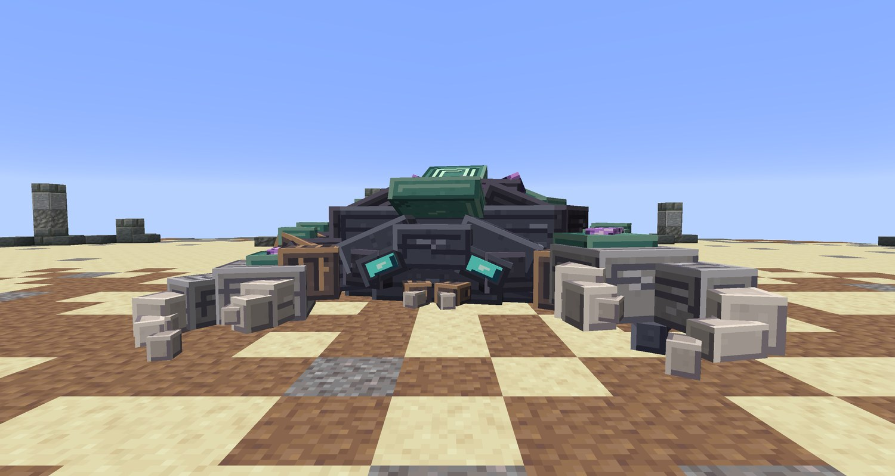

# 樱隙前线

樱隙前线是一张面向 Minecraft Java 版 26.3、约 320 × 240 格的浮岛建筑地图。布局包含贯穿主岛的中路、两侧的庭园和工业野区，以及通过双桥抵达的首领岛。

野怪以静态展示实体呈现，防御塔和水晶为建筑布景。配置对局时，需按本仓库的地图设施编辑流程另行设置路线、阵营设施和营地。

## 打开地图

1. 下载 [`cherry-rift-frontline.zip`](cherry-rift-frontline.zip)。
2. 将压缩包解压到 Minecraft 26.3 实例的 `saves/`。确认解压出的存档目录包含 `level.dat` 和 `resourcepacks/resources.zip`。
3. 在单人游戏中打开解压出的樱隙前线存档。存档自带资源包，加载后可看到六种自定义野怪模型。

## 编辑资源

- [Blockbench 模型](../../art_source/cherry-rift-frontline/)内嵌像素贴图。包含庭园野怪 `dusk_fox`、`frost_hare`、`jade_beast`，工业野怪 `heavy_walker`、`scout_bot`，以及首领 `rift_crab`。
- [地图资源包](resource-pack/)保留 Minecraft 26.3 读取的物品定义、几何和贴图。地图自带的 `resourcepacks/resources.zip` 对应这份资源包。

地图、原创模型和贴图遵循[项目许可范围](../../src/main/resources/META-INF/LICENSE-SCOPE.txt)。
